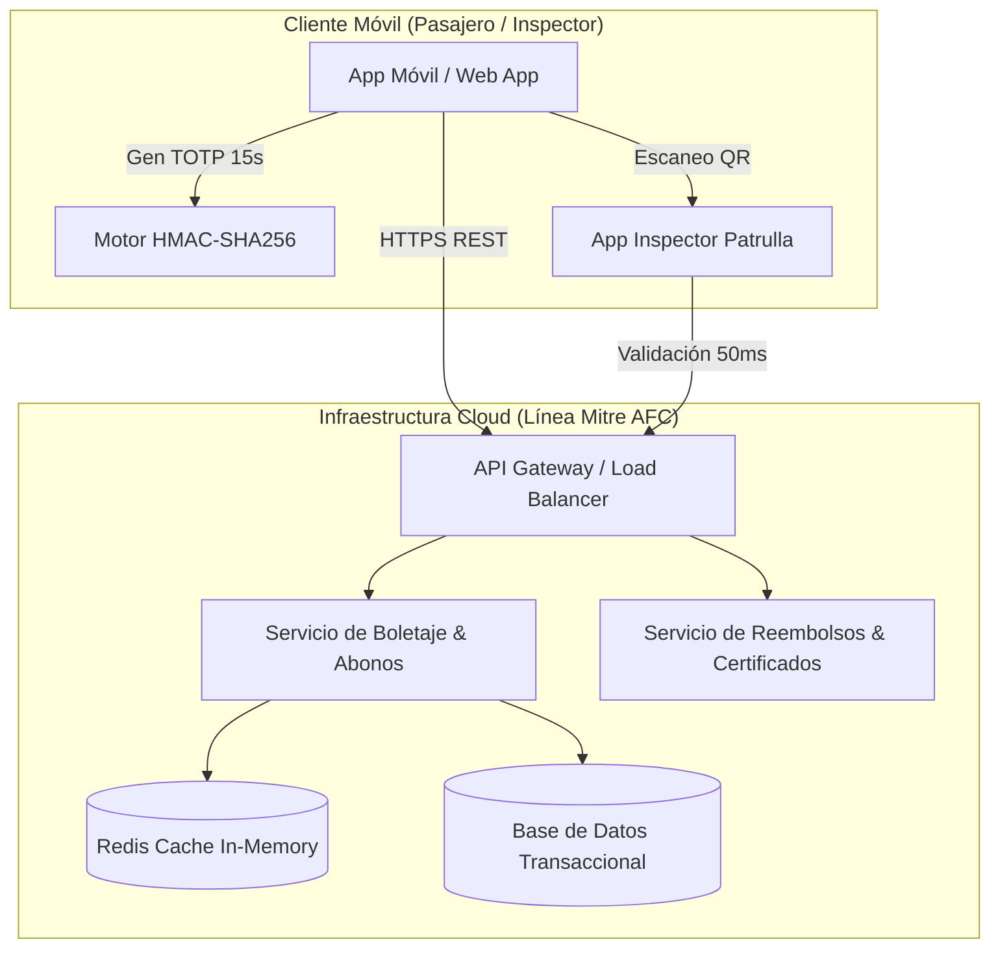

# 🚆 Sistema Móvil de Boletaje Digital Prepago (Línea Mitre)
> **Autor**: Santiago Nehuen Andrade Messali  
> **Trabajo Final Integrador / Tesis Universitaria**  
> *Desarrollo de un sistema móvil de boletaje digital prepago para reducir la evasión tarifaria en la Línea Mitre (AMBA)*

[](LICENSE)
[](#)
[](#)
[](#)

---

## 📌 Resumen Ejecutivo

En el Área Metropolitana de Buenos Aires (AMBA), la recaudación en sistemas de transporte ferroviario ha operado históricamente bajo esquemas cerrados (*closed-loop*) dependientes de tarjetas plásticas y boleterías físicas. Según datos oficiales de la **Secretaría de Transporte de la Nación (2024)**, la tasa general de evasión tarifaria alcanzó un **31,7%**, profundizada por la saturación de canales presenciales de carga y fallas de validación en estaciones intermedias.

Este proyecto presenta la arquitectura y prototipo funcional de un **Sistema de Recaudación Automática Abierto (Open-Loop AFC)** con emisión de **códigos QR dinámicos rotativos (TOTP - Time-Based One-Time Password)** vinculados al hardware del dispositivo móvil. 

El sistema elimina las filas de recarga, desmaterializa el pasaje, permite la compra anticipada de **abonos con descuento (hasta 50%)**, gestiona **devoluciones automáticas por demoras del servicio** y emite **certificados digitales oficiales de justificación laboral/escolar**.

---

## 🚀 Demo en Vivo

🔗 **Desplegado en Vercel**: `https://boleteria-digital-ferroviaria.vercel.app` *(O en tu enlace de Vercel)*  
💻 **Servidor Local**: `node local_server.js` (Disponible en `http://localhost:8080`)

---

## ✨ Funcionalidades Principales

### 1. 🎟️ Modo Pasajero: Boleto Único y Abonos Prepago
* **Cálculo Automático de Tarifa por Sección**: Retiro-Tigre, Retiro-J.L. Suárez y Retiro-B. Mitre (12 km, 24 km, >24 km).
* **Descuentos Progresivos por Precompra**:
  * 🎟️ *Boleto Único / Ocasional* (Tarifa base)
  * 📅 *Abono Semanal (10 viajes)*: **10% Descuento**
  * 🗓️ *Abono Mensual (40 viajes)*: **25% Descuento**
  * 🏆 *Abono Trimestral (120 viajes)*: **40% Descuento**
  * 🎓 *Abono Estudiantil / Universitario*: **50% Descuento**
* **Token Criptográfico TOTP**: Código QR dinámico que rota cada 15 segundos con marca de agua temporal en pantalla para impedir evasión por captura de pantalla (*screenshot*) o reenvío.

### 2. 💸 Devoluciones Automáticas por Fallas de Servicio
* **Garantía de Servicio**: Si la formación sufre demoras mayores a 15 minutos o una cancelación total, el pasajero puede solicitar la restitución inmediata del **100% del importe** a su billetera virtual.
* **Anulación Inmediata**: Al aprobarse el reembolso, el token criptográfico se invalida en tiempo real en los dispositivos de inspección.

### 3. 📜 Certificado Digital Institucional de Demora / Cancelación
* **Validez Laboral y Académica**: Genera un certificado impreso/PDF con sello de **Trenes Argentinos (SOFSE - Línea Mitre)**.
* **Verificación mediante QR Institucional**: Incluye Hash criptográfico `SHA-256`, datos del pasajero (Nombre y DNI), formación afectada y minutos de retraso oficiales para presentar ante empleadores o universidades.

### 4. 🔍 Dispositivo de Patrulla de Inspector (A Bordo)
* **Inspección en Movimiento**: Escaneo ultra-rápido de pasajes digitales.
* **Modo Online / Offline**: Comprobación matemática de firmas HMAC localmente en caso de baja cobertura celular dentro de vagones.
* **Feedback Visual Inmediato**:
  * 🟩 **VERDE**: Pasaje / Abono Válido (Pago verificado)
  * 🟨 **AMARILLO**: Código QR Expirado (> 15 segundos)
  * 🟥 **ROJO**: Infracción / Firma Invalidad / Captura Adulterada / Reembolsado

### 5. 📊 Dashboard de Operador y Métricas de Demanda
* Monitorización en tiempo real de la tasa de evasión evitada.
* Latencia del servidor (`< 50 ms` con arquitectura Redis).
* Mapa de demanda por horas pico en estaciones cabecera e intermedias.

---

## 🛠️ Arquitectura de Software



---

## 🔐 Protocolo Criptográfico TOTP (Anti-Evasión)

El token dinámico se rige bajo el algoritmo **TOTP (RFC 6238)** adaptado para transporte masivo:

$$\text{HMAC-Value} = \text{HMAC-SHA256}\left(K, \text{TicketID} \parallel \text{PassengerID} \parallel C\right)$$

Donde $C = \lfloor \frac{\text{Timestamp Actual}}{15 \text{ seg}} \rfloor$ representa la ventana de tiempo rotativa de 15 segundos y $K$ la clave simétrica única vinculada al `DeviceFingerprint` del usuario.

---

## 💻 Ejecución Local

No requiere dependencias complejas ni bases de datos externas para la demostración:

1. **Clonar el repositorio**:
   ```bash
   git clone https://github.com/CapScabio/Boleteria-digital-ferroviaria.git
   cd Boleteria-digital-ferroviaria
   ```

2. **Iniciar el servidor nativo Node.js**:
   ```bash
   node local_server.js
   ```

3. **Abrir en el navegador**:
   Navega a `http://localhost:8080`

---

## 🌐 Despliegue en Vercel

Este proyecto está optimizado como un **Web Application Standalone (Static HTML5/CSS3/JS)** sin pasos de compilación (*build steps*).

Para desplegarlo en Vercel:
1. Conecta tu cuenta de Vercel con GitHub.
2. Importa el repositorio `CapScabio/Boleteria-digital-ferroviaria`.
3. Mantén la configuración por defecto (`Framework Preset: Other` / Root directory: `./`).
4. Haz clic en **Deploy**. ¡Tu aplicación estará online en segundos!

---

## 📚 Referencias Bibliográficas (Normas APA 7)

* **Argentina.gob.ar. (2024).** *¿Qué encontramos? Informe sobre la emergencia ferroviaria*. Secretaría de Transporte de la Nación.
* **Barabino, B., Lai, C., & Olivo, A. (2020).** Fare evasion in public transport systems: a review of the literature. *Public Transport*, 12(1), 27-88.
* **Hollnagel, J., & Fook, A. (2019).** *The Future of Fare Media in Automated Fare Collection Systems for Urban Mobility in LAC*. Banco Interamericano de Desarrollo (BID).
* **Marazzi, M., Jattke, P., Zibung, J., & Razavi, K. (2024).** PayRide: Secure Transport e-Ticketing with Untrusted Smartphone Location. *Lecture Notes in Computer Science*, 261-282. Springer.
* **Nakkala, M., et al. (2025).** Digital Qr ticket: Smart solution for urban mobility. *International Journal on Science and Technology*, 16(1), 45-58.
* **Pike, S., Turner, K., Chin, S., & Nguyen, A. (2024).** Open to Open-Loop: Payments Challenges for Public Transit. *Transportation Research Findings*, 22(3), 102-115.

---

### ✒️ Autor
**Santiago Nehuen Andrade Messali** — *Tesis Universitaria 2026 (Línea Mitre AFC Digital Project)*
